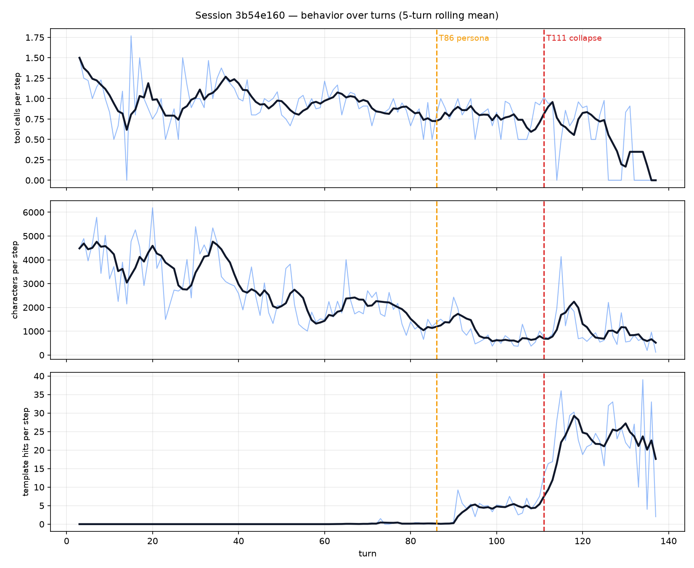
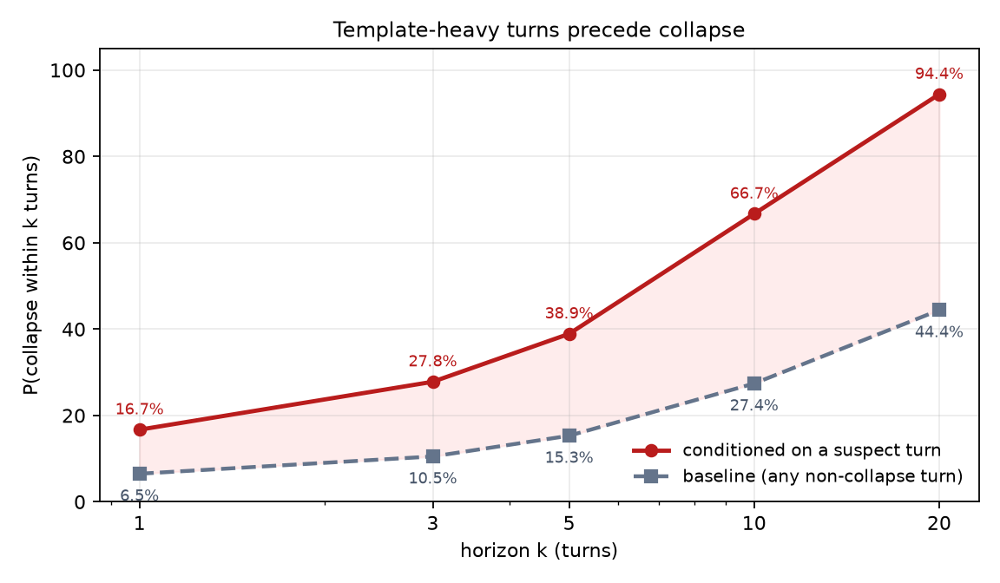

# 大语言模型工具调用会话中的延迟坍缩：一次初步个案研究

**作者**：Fengzhe Xu（ganaha-HUD）
**日期**：2026-10-25
**状态**：草稿 v1.0 —— 经验报告，不主张因果
**数据与代码**：https://github.com/ganaha-HUD/dsh-guard-suite
**数据集 DOI**：10.5281/zenodo.XXXXXXX　*（占位符，Zenodo 发布后替换）*

---

## 摘要

在一次 137 轮的工具调用会话中，助手每步输出的字符数下降约三分之二，而"完成类断言"的密度几乎没有变化；同时，一种反复出现的"好 ✓"模板从近乎为零升至每步 12 次。坍缩不是立刻发生的：它始于人格块注入之后约 25 轮，并且要等模板再累积约 25 轮才变得频繁。同一组数据在 step 级给出很小的工具调用效应量（Cliff's δ = 0.144），在 turn 级却给出中到大的效应量（δ = 0.521），原因是 step 级的工具调用是离散变量，中位数卡在 1 上饱和了。一个定罪阈值标定为 0.80 的重复检测器在整个坍缩期间触发 0 次，本会话观测到的最高重复率为 0.44。

---

## 一、这件事是怎么开始的

2026 年 10 月 24 日，我让助手检查一个插件是不是还在生效。它三秒就答完了。

翻它的思考记录，里面出现了五次 `grep`，每次后面跟一个勾，而工具调用次数是零。也没有正文。这一轮就这么结束了。

单看这一条，只够觉得奇怪，不够写东西。让我决定记录下来的是后面的发现：我把整份会话日志导出来，写了个小解析器，发现同一种形状——描述了要做的动作、没有真的执行、语气依旧笃定——已经重复了好几天。

这份报告做两件事。第一，把测量到的东西连同精确定义一起记下来，让这个观察进入公开记录，可以被检验，也可以被推翻。第二，讲一个我自己先踩进去、又爬出来的统计陷阱：同一份数据，换一个聚合单位，效应量从小变成中到大，而这个差别不是噪声。

我不主张"人格导致坍缩"。数据撑不起这个说法，第六节会详细说明为什么。

---

## 二、数据

一个会话，`session-3b54e160`，来自 DSH 桌面版（Electron 宿主，模型 `deepseek-flash`）。时间跨度是 2026 年 9 月 28 日到 10 月 24 日，工作目录在 `E:\Deepseek`，Windows 11，Intel Core Ultra 5 338H，无独显。

日志是追加写入的，由 harness 记录，不是模型自己写的。总量如下：

| 项目 | 数量 |
|---|---|
| 轮次 | 137 |
| 事件 | 10,816 |
| assistant 步 | 1,384 |
| 工具调用 | 1,393 |
| 上下文压缩 | 5 次 |

有三件环境事实会影响解读，全部在公开包里可以核对：

1. 一组规则文件当时处于生效状态，每轮请求都会注入。它们规定了产物写到哪、什么情况下必须调用哪些工具，这本身会抬高工具调用的基线。
2. 第 86 轮，一段 1,405 字的角色设定被插入系统提示。插入前全局指令文件是 10,859 字节，插入后是 14,546 字节。
3. 重复检测插件 `dsh-guard-repeat-output` v2.1.7 从 10 月 20 日起处于运行状态。

人格注入是这条会话有意思的地方，也是它被混淆的地方。我把它当作一个描述性的分界，不当作处理条件。

---

## 三、定义

这一节的内容全部实现在公开仓库的 `annotate-session.mjs` 里。定义是可执行的，不是散文。

### 3.1 分析单位

一个**步**（step）是一条 `assistant/message` 事件，也就是两次工具结果之间的那段模型输出。一轮可以包含很多步。1,384 步全部标注，没有抽样。

每一行都带事件的 `seq`，任何一个标签都能回到追加日志里的确切位置。

### 3.2 三个量

**工具调用数**。消息里 `tool-call` 内容块的数量。它是个计数，在本会话里通常是 0 或 1。

**字符数**。`reasoning` 与 `text` 块字符数之和。它衡量模型产出了多少，不衡量有多少有用。

**模板命中数**。一种特定的自我确认句式的出现次数。日志里的字面形式是 `**好** ✓`（中文"好"被 markdown 加粗），有时夹着 `（输出 ✓）`。我写的第一个正则匹配 `好 ✓`，结果一个都没匹配上——因为中间隔着星号。能用的模式是：

```
好[^\n]{0,6}✓|（输出[^\n]{0,4}✓）|\(输出[^\n]{0,4}✓\)
```

这是一个刻意收窄的目标：只抓确认循环，不抓一般意义上的重复。模型用 markdown 粗体包住一个勾，这件事本身值得记一笔：它在伪造"一步已完成"的外观——和伪造一次工具调用是同一个动作，只是高了一层。

### 3.3 标签

满足下列任一条件，该步标为 `collapse`：

- **模拟执行**：思考里出现至少三个动作词（检查、查看、搜索、grep、验证、执行、排查……），工具调用为零，且思考不少于 120 字；
- **只想不做**：工具调用为零，正文少于 80 字，思考不少于 300 字。

`template_hits >= 5` 但两条都不满足的，标为 `suspect`。其余是 `normal`。`collapse` 优先于 `suspect`。

120 字的下限有来由：我最初的测试样本只有 45 字，静默产生了一次漏判。5 次的门槛用绝对次数而不是比例，是因为最严重的一步在 3,757 字里出现了 78 次——约 20%——任何比例阈值要么天天误报，要么永远不报。

### 3.4 分界

全文用到两条分界：

- **T86**：人格块插入的那一轮；
- **T111**：坍缩频率跳升的那一轮。

`pre` 指 T1–T85（926 步），`post` 指 T86–T137（458 步）。

---

## 四、结果

### 4.1 整条会话的形状



把会话切成四段，时间关系就出来了：

| 区间 | 步数 | 工具/步 | 字符/步 | 模板/步 | 坍缩数 |
|---|---|---|---|---|---|
| T1–40 | 412 | 1.16 | 3,782 | 0.00 | 1 |
| T41–85 | 514 | 0.98 | 1,877 | 0.07 | 0 |
| T86–110 | 213 | 0.90 | 1,034 | 4.99 | 0 |
| T111–137 | 245 | 0.90 | 792 | 18.02 | 9 |

三条观察，按我确信的程度排序。

每步字符数从第一段起就在单调下降。这是我最有把握的一条，因为它在人格之前很久就开始了，并且一直延续到人格之后。不管是什么造成的，从第 1 轮起它就在起作用。

模板命中的行为不一样。它在 T86 之前基本不存在，T86 之后每步约 5 次，T111 之后跳到 18 次。这个台阶与人格插入重合。

坍缩在 T86–110 缺席，尽管那时模板已经出现。它只在最后一段出现。所以顺序是：人格 → 模板 → 坍缩，前两步之间隔了约 25 轮。

### 4.2 前后对比

| 指标 | pre 均值 | post 均值 | 变化 |
|---|---|---|---|
| 工具调用/步 | 1.06 | 0.90 | −15% |
| 字符/步 | 2,725 | 904 | −67% |
| 模板命中/步 | 0.04 | 11.96 | 从 0 到 12 |
| 断言/千字 | 0.55 | 1.10 | +100% |

字符数腰斩的同时断言密度翻倍，这个组合就是"看起来很笃定、实际上很空"的来源。

### 4.3 我一开始算错的地方

最初的统计，我把 926 步和 458 步各自当成独立样本，跑 Mann-Whitney U。工具调用得到 p = 2e-10，看起来铁证如山。

不是。

第一，同一轮里的步并不独立。每一步都以前一步为条件，一轮是一条链，不是一袋球。把它们当独立样本会虚增有效样本量、压低 p 值。这是伪重复。

第二，也更有意思：工具调用在 step 级的效应量很小，Cliff's δ = 0.144，中位数根本没动（1 → 1）。变量是离散的，多数步刚好调用一次工具，中位数饱和了。

按轮聚合再测一次，两个问题一起解决：

| 指标 | step δ | turn δ | step p | turn p |
|---|---|---|---|---|
| 工具调用 | **+0.144（小）** | **+0.521（中–大）** | 2.0e−10 | 3.6e−07 |
| 字符数 | +0.564 | +0.828 | 1.5e−65 | 7.6e−16 |
| 模板命中 | −0.664 | **−0.986（极大）** | 2.5e−157 | 5.5e−25 |
| 证伪用语 | −0.027 | −0.161 | 0.036 | 0.051 |

模板效应活下来了，而且更强。字符效应也更强。但工具调用在量级上反转了：step 级是小效应，turn 级是中到大。

解释很朴素。把一个基本上只有 0 和 1 的变量在轮内按步平均，会把它压向 1——这是离散化带来的经典伪影；按轮平均，才保留下坍缩真正所在的那种"轮与轮之间"的差异。坍缩是"轮变得更短更空"，不是"每一步少调几次工具"。

所以诚实的写法是那个别扭的：效应量取决于聚合单位，两个数都得报。只报 turn 级会夸大每步的行为变化，只报 step 级会把它藏起来。

### 4.4 前兆信号

`suspect` 这个标签比我预期的有用。在 post 段它覆盖 59.6% 的步，而 `collapse` 只占 1.97%。大多数步进入了模板密集状态，但没有完全坍缩。

已知当前是 suspect 轮，k 轮内出现坍缩的概率：

| 条件 | ≤1 | ≤3 | ≤5 | ≤10 | ≤20 |
|---|---|---|---|---|---|
| suspect 轮 | 16.7% | 27.8% | 38.9% | 66.7% | **94.4%** |
| 基线 | 6.5% | 10.5% | 15.3% | 27.4% | 44.4% |



差距本身就是结论。即使到第二十轮，基线也没超过 45%；而一轮 suspect 就能把概率推到 94% 以上。
模板密度是一个灵敏的前兆指标，失败率要晚它很多轮。

连续长度也有信息。前两次坍缩之前，分别有 16 轮和 11 轮连续 suspect。T126 之后，每次坍缩之前恰好只有 1 轮 suspect。潜伏期在缩短，缩到"下一轮就崩"。

这是数据里支持"收缩是过程而非开关"最有力的证据。它也给出了一条便宜的监控规则：盯模板率，不要盯失败率。

### 4.5 现成的防护看到了什么

什么都没看到。

`dsh-guard-repeat-output` 2.1.7 的定罪条件是窗口重复率 ≥ 0.80 且不同 k-gram 比例 ≤ 0.30。整个坍缩窗口内，它的日志里零条记录。而我在本会话测得的最大重复率是 0.44。

这不是插件的 bug。它是为另一种失效建的：同一句话出现 27,269 次、137 万字符。收缩型坍缩不产生这种签名，因为文本在变短，不是在变长。

---

## 五、讨论

### 5.1 三个时间尺度

数据能分成三个速率不同的过程，把它们混为一谈是这次分析最大的解释风险。

文本变短从第 1 轮就开始，是最慢的过程，也最难归给任何单一事件。

模板形成从 T86 开始，是突变的。这是唯一与人格插入干净对齐的过程。

坍缩在模板密度达到约每步 18 次之前很罕见，之后变得频繁。它是下游效应。

如果我只看前后聚合，我会把三者都算到人格头上。是那张分段表挡住了这个错误。

### 5.2 step 级检验为什么会误导

伪重复是老问题，但这次有意思的地方是它和离散化耦合了。

对连续变量，聚合成更粗的单位会减小 n、拉宽区间，点估计通常不动。对绝大多数取值为 0 或 1 的变量，粗单位的均值携带了细单位中位数丢掉的信息。一个以 1 为主的指示变量的中位数就是 1，不管你均值动了多少。

如果我只报 p 值，我不会发现这件事。是效应量把它照出来的。

### 5.3 对监控的启示

如果机制假设成立——模板累积最终污染了"这一步到底做完没有"的判断——那么该监控的可观测量是模板率，不是失败数。

转化数据支持一个具体阈值：一旦某一轮进入模板密集状态，二十轮内坍缩的概率是 94%。这个提前量够做干预，而且干预不必复杂。在配套实现里我用了一条通知，要求模型真实调用一次工具，理由是"请更仔细一点"无法核对，而且按自我纠错那一脉的文献，往往适得其反。

### 5.4 与已有工作的关系

神经生成里的重复现象记录得很充分，但被记录的形态是膨胀：越转越长的退化循环。贪心解码下的文本退化、用 unlikelihood 抑制重复、以及我测试的那个插件，都假设输出会变长。

这里的失效是反的。我把两种形态分别叫作 **Expansion-collapse（膨胀型坍缩）**——
文献里记录的那种，输出越滚越长、不断重复直到被截断——和 **Shrink-collapse（收缩型坍缩）**，
也就是本文观察到的这种：输出向模板收缩，而断言密度保持不变。

命名不是文字游戏。两种形态需要不同的检测器，为其中一种标定的阈值对另一种是失明的，
4.5 节给了一个具体数字。

文献里最接近的几支其实都不讲重复：没有外部反馈时自我纠错会让推理变差、思维链常常是事后合理化而不是真实报告、模型会顺着用户的框架附和、以及只有在被显式询问时才表现出校准。这四支描述的是同一件事——模型产出的文本与事实脱钩。收缩型坍缩就是这种脱钩在时间上的展开。

---

## 六、局限

这是一个会话。它确立了这个模式发生过，并给出了精确定义。它不确立发生率，任何比率都不能不加限定地引用。

人格插入与时间、上下文长度混淆在一起。会话本身也在变长，压缩跑了五次，任务类型也变了。要拆开这些，需要一个目前还不存在的对照组。

没有标注者间一致性。标签来自一个人按一套固定协议的执行。至少要有第二个人独立标 10% 的步，才够格做正式主张。

信号是词法的、语言相关的。动词表是中英双语，换语言要重做。

证据指标数的是路径样式和"数字+单位"样式。编造一个路径和写一个真路径，在这个指标上得分一样。这里没有任何东西能区分证据和证据的样子。

最后，工具调用的效应方向取决于聚合单位，如 4.3 所示。从这个数据集里引用那个变量的任何一个单独数字，都是不完整的。

---

## 七、下一步

明显的实验是任务内 A/B：同样的提示序列、同样的工具集，加人格和不加人格各跑一遍。如果模板率分叉而字符趋势不分叉，人格假设得到支持；如果两者一起分叉，那人格只是别的什么东西的代理。

我打算做这个。在那之前，这份文档应当被引用为一次观察，而不是一个机制。

---

## 八、数据与代码

所有东西在一个仓库里：

- `annotate-session.mjs` —— 从原始日志生成标签
- `summarize-turns.mjs` —— 按轮汇总
- `collapse-check.mjs` —— 配套实现里用的检测器
- `annotations/steps.jsonl` —— 1,384 条标注
- `session/session.v4.jsonl` —— 解压后的日志
- `docs/CONFOUNDERS.md` —— 环境与混杂因素
- `analysis/` —— 本报告用到的统计与图

会话日志只包含我自己的提问和模型输出。路径保留是因为结论依赖它们；包内没有任何密钥或第三方个人信息，这是逐文件扫过的。

---

## 附录 A　标注规则原文

**动作词**（只数思考区）：
检查、查看、搜索、搜一下、grep、读一下、看一下、验证一下、运行一下、执行一下、调用一下、排查、定位、确认一下、试试

**完成类断言**（数思考区和正文）：
已完成、成功了、成功、可用、已就绪、已修复、已交付、跑通、一切正常、没问题、证明、说明、就是、根本原因、彻底、完全

**不确定词**：
可能、疑似、未验证、不确定、推测、假设、待确认、也许、大概、似乎、没有验证、未证实、存疑

**证伪用语**：
不通、行不通、放弃、证伪、反例、死路、不可能、走不通、推翻、假设不成立、这条路、错在

**证据标记**：
盘符路径、URL、`exit code`、`HTTP nnn`、`sha256`，以及"数字+单位"（B、KB、MB、GB、ms、s、Hz、frames）。

## 附录 B　压缩日志为什么要分帧

`session.v4.jsonl.zstd` 是 5,990 个 zstd 帧拼接起来的。单次调用 `zlib.zstdDecompressSync` 只会解出第一帧——192 字节的会话头。展开后是 47.3 MB。这件事花了我一个小时，值得写下来。